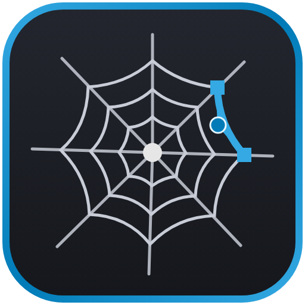
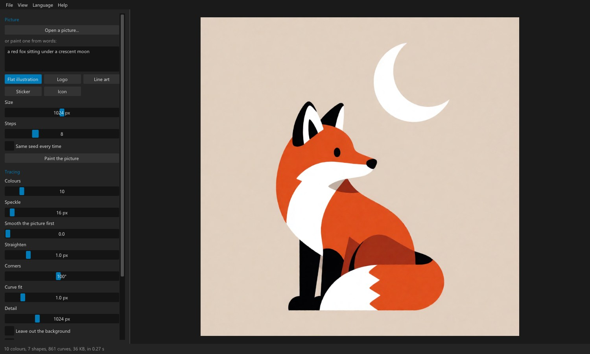

[](https://x.com/NorowaretaGemu)
[](https://opensource.org/licenses/MIT)

<br>
<div align="center">
  <a href="https://ko-fi.com/cursedentertainment">
    
  </a>
</div>
<br>
<div align="center">
  
  
  
  
  
</div>
<div align="center">
  
  
  
</div>
<br>

<div align="center">
  
</div>

# Arachne

**Pictures into clean vector art.** Arachne traces a picture into an SVG of flat shapes and smooth Bezier curves, on
your own PC, in C++: no gaps between the shapes, holes kept, corners kept sharp. Or describe a picture and Arachne
paints it first (Krea 2 Turbo, on your graphics card), then traces it. Part of
**[Atelier](https://github.com/CursedPrograms/Atelier)**, Cursed Entertainment's creative suite.
**[Website](https://cursedprograms.github.io/Arachne/)**



## Features

- **The tracer, Arachne's own:** the picture is reduced to a few colours (k-means in Lab), speckles are merged into
  what surrounds them, the shapes are stacked so there are no hairline gaps, outlines keep their holes, pixel
  stair-steps are flattened, sharp turns stay corners, and smooth cubic Beziers are fitted. A 512 px illustration
  traces in about 0.1 s, a 1024 px photo in about 0.3 s.
- **Paint from words:** type what you want, pick a style (flat illustration, logo, line art, sticker, icon), and
  Arachne paints it with Krea 2 Turbo through stable-diffusion.cpp (CUDA), then traces it. The models stay loaded
  between pictures.
- **Every setting a slider:** colours, speckle, smoothing first, straighten, corners, curve fit, detail, leave out the
  background, outlines and their width; painting size and steps.
- **See what it did:** the picture, the vector art, or both with a wipe to drag (keys 1, 2, 3), and the colours used.
- **Save it:** the SVG, a PNG of it at any size (vector art draws sharp at any size), or copy the SVG to paste.
- **arachne-cli:** the same tracer from the command line, with `--render` to draw the SVG back and measure it.
- **Twelve languages:** English, Japanese, Chinese, Spanish, Korean, French, German, Russian, Serbian, Afrikaans,
  Yucatec Maya and Pennsylvania Dutch (Language menu).
- Opens empty; drop a picture on the window or open one. Preferences can reopen the last picture.

## Minimum requirements

| | |
| --- | --- |
| **System** | Windows 10 or 11, 64-bit (the tracer, arachne-cli, also builds on Linux) |
| **Processor** | any 64-bit processor (tracing runs on the CPU: a fraction of a second a picture) |
| **Memory** | 4 GB RAM to trace; 16 GB to paint from words (the models sit in memory) |
| **Graphics** | any graphics card with OpenGL 3.0 to trace; painting from words needs an NVIDIA card with 6 GB or more (CUDA) |
| **Disk** | 600 MB for the app; painting also needs Krea 2 Turbo, about 13 GB (Firmament's models: one download for both) |

## Install

Download **Arachne-win64.zip** from [Releases](https://github.com/CursedPrograms/Arachne/releases), unzip it and run
`install.bat` beside it (Start menu and Desktop shortcuts), or run `Arachne.exe` where it is. It's also in the
[Atelier launcher](https://github.com/CursedPrograms/Atelier).

Tracing works straight away. To paint from words, Arachne uses **Krea 2 Turbo**, the same models as
[Firmament](https://github.com/CursedPrograms/Firmament): get them in Firmament's Models tab and Arachne finds them
there, or put them in a `models` folder beside Arachne (`models/krea2/diffusion_models`, `text_encoders`, `vae`).

## The command line

```
arachne-cli picture.png picture.svg [--colours 12] [--speckle 16] [--work 1024] [--smooth 0] [--straighten 1]
                                    [--corner 100] [--fit 1] [--drop-background] [--outlines] [--render check.png]
```

`--render` draws the SVG back to a PNG and prints how far it is from the picture (mean difference, 0-255).

## Build

Windows: Visual Studio 2022 (C++), CMake, the CUDA 12 toolkit, and
[stable-diffusion.cpp](https://github.com/leejet/stable-diffusion.cpp) built as a shared library with CUDA
(`cmake -DSD_CUDA=ON -DSD_BUILD_SHARED_LIBS=ON -DCMAKE_CUDA_RUNTIME_LIBRARY=Shared`, in `build-cuda`), then
`build.bat` (or `build.ps1`) with `SDCPP` pointing at its folder. It builds `build/Release/` and
`dist/Arachne-win64.zip`; `install.bat` / `install.ps1` install it. `stable-diffusion.dll` is delay-loaded, so Arachne
traces on any PC and only painting needs the NVIDIA card.

Linux: `./build.sh` builds `arachne-cli` (cmake, a C++17 compiler); `./install.sh` puts it in `~/.local/bin`.

The code, in `src/`:
- `trace.cpp`: the tracer: colours, speckles, stacked shapes, outlines with holes, corners, Bezier fitting, the SVG
- `engine.cpp`: painting from words (stable-diffusion.cpp, Krea 2 Turbo)
- `gui.cpp`: the window (SDL2, OpenGL 3, Dear ImGui); `splash.cpp`, `lang.cpp` (the language packs in `lang/`)
- `cli.cpp`: `arachne-cli`

## Credits

Painting: [stable-diffusion.cpp](https://github.com/leejet/stable-diffusion.cpp) (MIT, on
[ggml](https://github.com/ggml-org/ggml), MIT) running Krea 2 Turbo (not shipped: see Install). Built with
[SDL2](https://www.libsdl.org), [Dear ImGui](https://github.com/ocornut/imgui), [stb](https://github.com/nothings/stb)
and [nanosvg](https://github.com/memononen/nanosvg) (zlib). See [NOTICE](NOTICE).

<br>
<div align="center">
© Cursed Entertainment 2026
</div>
<br>
<div align="center">
<a href="https://cursed-entertainment.itch.io/" target="_blank">
    
</a>
</div>
